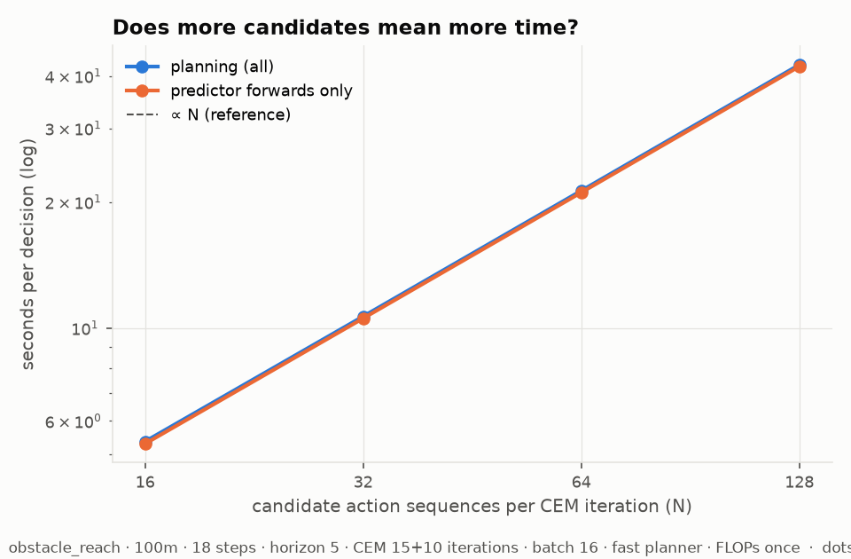
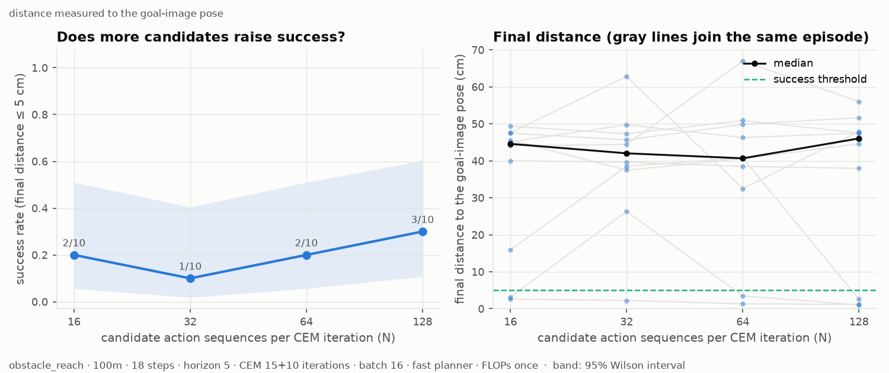
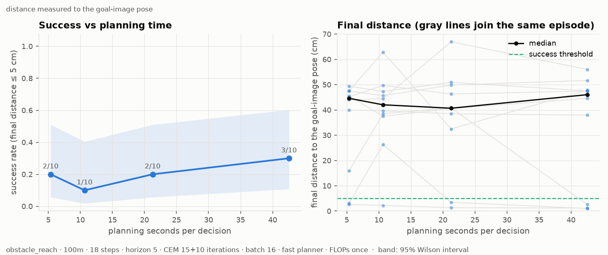
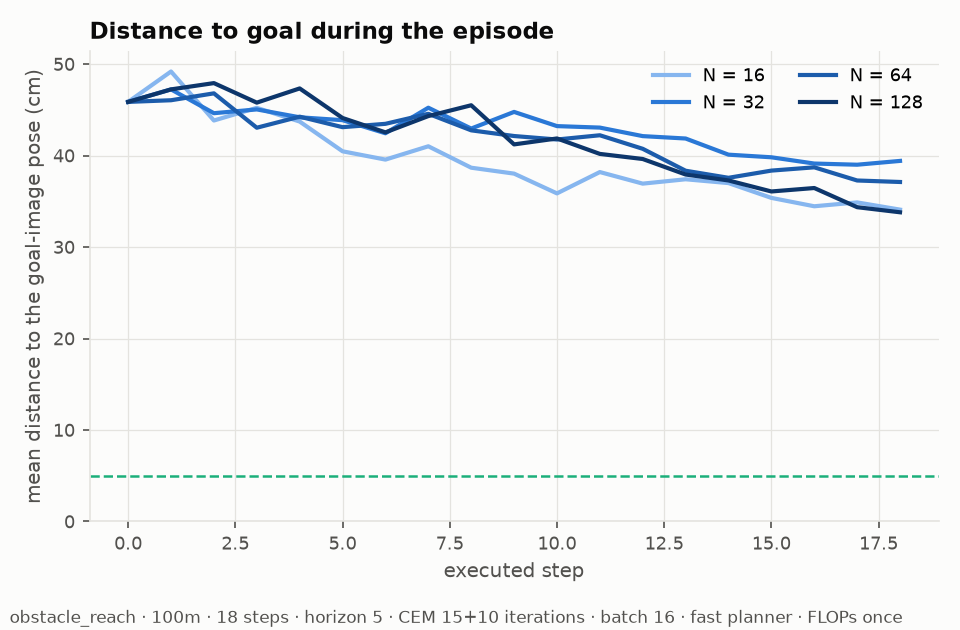
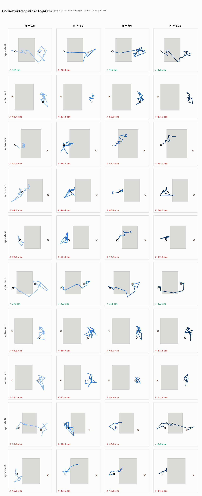

# obstacle_reach · 100m · candidates ladder

> **Preliminary report (snapshot, 2026-11-26).** 100M world model, ObstacleReach scene 0, seeds 0–9, candidates per
> CEM iteration N = 16/32/64/128, on one RTX 5090. Copied from `results/ladder_100m/report/` (generated by
> `python -m experiments report results/ladder_100m`); per-episode videos and CSVs are not tracked in git. Read
> per-seed results with the [goal image vs env target](../../experiments/README.md#goal-image-vs-env-target) caveat:
> on 5 of the 10 seeds the goal image was rendered 12–20 cm above the sampled target, which makes those goals easier.
> 10 episodes per N give wide confidence intervals; no trend in success with N is established yet.

obstacle_reach · 100m · 18 steps · horizon 5 · CEM 15+10 iterations · batch 16 · fast planner · FLOPs once

Success = final end-effector distance to the goal-image pose ≤ 5 cm (provisional). The goal-image pose is where the arm was when the goal image was rendered (what the planner is asked to match); the env target is the env's sampled point used by its reward. They differ when the env's expert stopped short while rendering the goal: mean gap 7.9 cm in this run. Time = wall-clock planning time per executed step (decision); predictor = synchronized time inside predictor forwards.

| N | batches × size | elites | episodes | success | final distance cm, median [IQR] | to env target cm (median) | planning s/decision | predictor s/decision | predictor ms/call | episode min |
|---|---|---|---|---|---|---|---|---|---|---|
| 16 | 1 × 16 | 4 | 10 | 2/10 (20%, CI 6–51) | 44.6 [21.9–47.0] | 43.3 | 5.4 | 5.3 | 57.1 | 3.6 |
| 32 | 2 × 16 | 4 | 10 | 1/10 (10%, CI 2–40) | 42.0 [37.7–46.9] | 41.8 | 10.7 | 10.5 | 57.2 | 5.2 |
| 64 | 4 × 16 | 4 | 10 | 2/10 (20%, CI 6–51) | 40.7 [34.0–48.9] | 40.7 | 21.3 | 21.1 | 57.3 | 8.5 |
| 128 | 8 × 16 | 4 | 10 | 3/10 (30%, CI 11–60) | 46.0 [11.4–47.8] | 43.9 | 42.6 | 42.2 | 57.4 | 14.8 |

## Planning time vs candidates

## Success vs candidates

## Success vs planning time

## Distance to goal during the episode

## End-effector paths with the obstacle

## Final distance per episode (cm; ✓ = success)

| episode | N=16 | N=32 | N=64 | N=128 |
|---|---|---|---|---|
| 0 | [✓ 3.2](episodes/n0016_seed00000/) | [✗ 26.3](episodes/n0032_seed00000/) | [✓ 3.5](episodes/n0064_seed00000/) | [✓ 1.0](episodes/n0128_seed00000/) |
| 1 | [✗ 49.4](episodes/n0016_seed00001/) | [✗ 47.3](episodes/n0032_seed00001/) | [✗ 50.9](episodes/n0064_seed00001/) | [✗ 47.5](episodes/n0128_seed00001/) |
| 2 | [✗ 40.0](episodes/n0016_seed00002/) | [✗ 39.7](episodes/n0032_seed00002/) | [✗ 38.5](episodes/n0064_seed00002/) | [✗ 38.0](episodes/n0128_seed00002/) |
| 3 | [✗ 44.1](episodes/n0016_seed00003/) | [✗ 44.4](episodes/n0032_seed00003/) | [✗ 66.9](episodes/n0064_seed00003/) | [✗ 56.0](episodes/n0128_seed00003/) |
| 4 | [✗ 47.6](episodes/n0016_seed00004/) | [✗ 62.8](episodes/n0032_seed00004/) | [✗ 32.5](episodes/n0064_seed00004/) | [✗ 47.9](episodes/n0128_seed00004/) |
| 5 | [✓ 2.6](episodes/n0016_seed00005/) | [✓ 2.2](episodes/n0032_seed00005/) | [✓ 1.3](episodes/n0064_seed00005/) | [✓ 1.2](episodes/n0128_seed00005/) |
| 6 | [✗ 45.1](episodes/n0016_seed00006/) | [✗ 49.7](episodes/n0032_seed00006/) | [✗ 46.3](episodes/n0064_seed00006/) | [✗ 47.5](episodes/n0128_seed00006/) |
| 7 | [✗ 47.5](episodes/n0016_seed00007/) | [✗ 45.6](episodes/n0032_seed00007/) | [✗ 49.8](episodes/n0064_seed00007/) | [✗ 51.7](episodes/n0128_seed00007/) |
| 8 | [✗ 15.9](episodes/n0016_seed00008/) | [✗ 38.5](episodes/n0032_seed00008/) | [✗ 40.8](episodes/n0064_seed00008/) | [✓ 2.6](episodes/n0128_seed00008/) |
| 9 | [✗ 45.6](episodes/n0016_seed00009/) | [✗ 37.5](episodes/n0032_seed00009/) | [✗ 40.6](episodes/n0064_seed00009/) | [✗ 44.6](episodes/n0128_seed00009/) |

Each link holds `trajectory.png` (top-down + side view with the obstacle). The matching `video.mp4` files are in the local run directory only.
